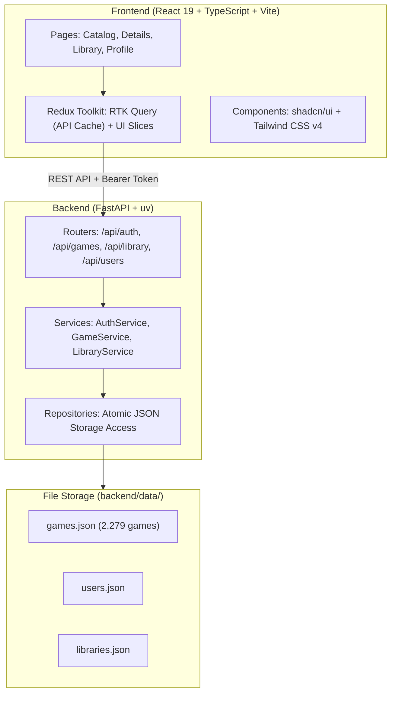

# 🎮 GameLibrary

A full-stack web application for organizing, tracking, and rating personal video game collections with a catalog of **2,279+ titles**, real-time filtering, personal library management, statistics, and full dark/light theme support.

Built with **FastAPI** (Python 3.11+, uv, Pydantic v2) on the backend and **React 19** (TypeScript, Vite, Tailwind CSS v4, shadcn/ui, Redux Toolkit) on the frontend.

---

## ⚡ Quick Start

### Option A: One-Click Windows Launchers (Recommended)

| Script | Purpose |
| :--- | :--- |
| **[`start.bat`](./start.bat)** | Syncs dependencies, starts backend (`:8001`) and frontend (`:5174`), and opens the app in your default browser. |
| **[`stop.bat`](./stop.bat)** | Safely terminates all dev server processes running on ports `8001` and `5174`. |
| **[`check.bat`](./check.bat)** | Runs quality gate: linters (Ruff, Oxlint), formatters (Ruff, Prettier), and typecheckers (Mypy, TypeScript). |
| **[`test.bat`](./test.bat)** | Executes the automated backend smoke test suite (`TC-AUTH`, `TC-CAT`, `TC-LIB`, `TC-PROF`, `TC-INT`). |

### Option B: Manual CLI Launch

#### 1. Backend API (FastAPI)
```bash
cd backend
uv sync
uv run dev
```
* Backend API: [http://localhost:8001](http://localhost:8001)
* Interactive Swagger Docs: [http://localhost:8001/docs](http://localhost:8001/docs)
* Health Check: [http://localhost:8001/health](http://localhost:8001/health)

#### 2. Frontend UI (React + Vite)
```bash
cd frontend
npm install
npm run dev
```
* Web Application: [http://localhost:5174](http://localhost:5174)

---

## 🌟 Core Features

- **Extensive Catalog**: Over **2,279 games** with titles, high-resolution cover artwork, descriptions, release years, genres, platforms, and developers.
- **Search & Multi-Filtering**: Real-time title search combined with genre and platform filter chips.
- **Personal Library Tracker**:
  - Add games with default status: *"Want to Play"*.
  - Track progress: *"Want to Play"* $\rightarrow$ *"Playing"* $\rightarrow$ *"Completed"*.
  - Personal 1–10 star/score ratings.
  - Remove games from library without modifying global catalog.
- **User Dashboard & Statistics**: Real-time calculated metrics: total games, counts per status category, and average personal rating.
- **Authentication & Tenant Isolation**: Secure user registration, login with JWT bearer tokens, and strict isolation between users' private libraries.
- **Dark & Light Mode**: Seamless theme switching with persistent user preference.

---

## 🏛️ System Architecture



---

## 📁 Repository Structure

```text
├── .agents/                    # Antigravity AI Agent configuration
│   ├── hooks.json              # Full-lifecycle hooks (PreToolUse, PostToolUse, PreInvocation, Stop)
│   ├── rules/                  # Modular scoped architecture and style rules
│   │   ├── backend-architecture.md
│   │   ├── frontend-architecture.md
│   │   └── coding-style.md
│   ├── scripts/                # Hook execution handlers (hook_handler.py)
│   └── skills/                 # Agent domain skills (api-testing, run-app)
├── backend/                    # FastAPI Backend
│   ├── app/
│   │   ├── main.py             # FastAPI entry point & CORS configuration
│   │   ├── routers/            # HTTP endpoints
│   │   ├── services/           # Domain business logic
│   │   ├── repositories/       # Data persistence layer
│   │   ├── models/             # Pydantic schemas (DTOs)
│   │   └── utils/              # Atomic JSON store utilities
│   ├── data/                   # JSON data stores (games.json, libraries.json, users.json)
│   ├── scripts/                # Automated test runner (test_api.py)
│   └── pyproject.toml          # uv package dependencies
├── frontend/                   # React 19 + TypeScript Frontend
│   ├── src/
│   │   ├── features/           # Feature-based views (games, auth)
│   │   ├── store/              # Redux Toolkit & RTK Query endpoints
│   │   ├── components/         # Shared UI & layout components (Navbar, ThemeToggle)
│   │   └── hooks/              # Custom React hooks (useAuth, useTheme)
│   ├── package.json
│   └── vite.config.ts
├── docs/                       # Project documentation
│   └── games/                  # Business requirements, architecture, test cases
├── start.bat                   # One-click full-stack launcher
├── stop.bat                    # One-click dev server shutdown
├── test.bat                    # One-click smoke test runner
├── AGENTS.md                   # AI Assistant primary entry guide
└── README.md                   # Project overview & documentation
```

---

## 🧪 Testing & Verification

Automated smoke tests cover all requirements in `docs/games/test-cases.md`:

```bash
# Run tests via batch script:
test.bat

# Or via CLI:
cd backend
uv run python -m scripts.test_api
```

Test suite coverage:
- `TC-AUTH`: User registration, duplicate conflict prevention, login validation, token auth guard.
- `TC-CAT`: Catalog listing, title search, genre filter, platform filter, game details.
- `TC-LIB`: Add game (default "want_to_play"), prevent duplicate addition, update status, submit rating (1–10), removal.
- `TC-PROF`: Profile statistics and average rating calculations.
- `TC-INT`: Multi-user tenant isolation and global catalog immutability.

---

## 🤖 Antigravity AI Agent System

This project is configured with a modern, modular agent infrastructure:
- **Modular Rules** (`.agents/rules/`): Automatically applied based on the working directory (`backend/**` vs `frontend/**`).
- **Lifecycle Hooks** (`.agents/hooks.json`):
  - **`PreToolUse`**: Security guard preventing destructive system commands and protecting sensitive files (`.git/`, `.env`, `games.json`).
  - **`PostToolUse`**: Automated Python syntax checks, JSON store integrity verification, and audit logging.
  - **`PreInvocation`**: Dynamic context injection with real-time server and database metrics.
  - **`Stop`**: Quality gate ensuring database files are undamaged before concluding tasks.
